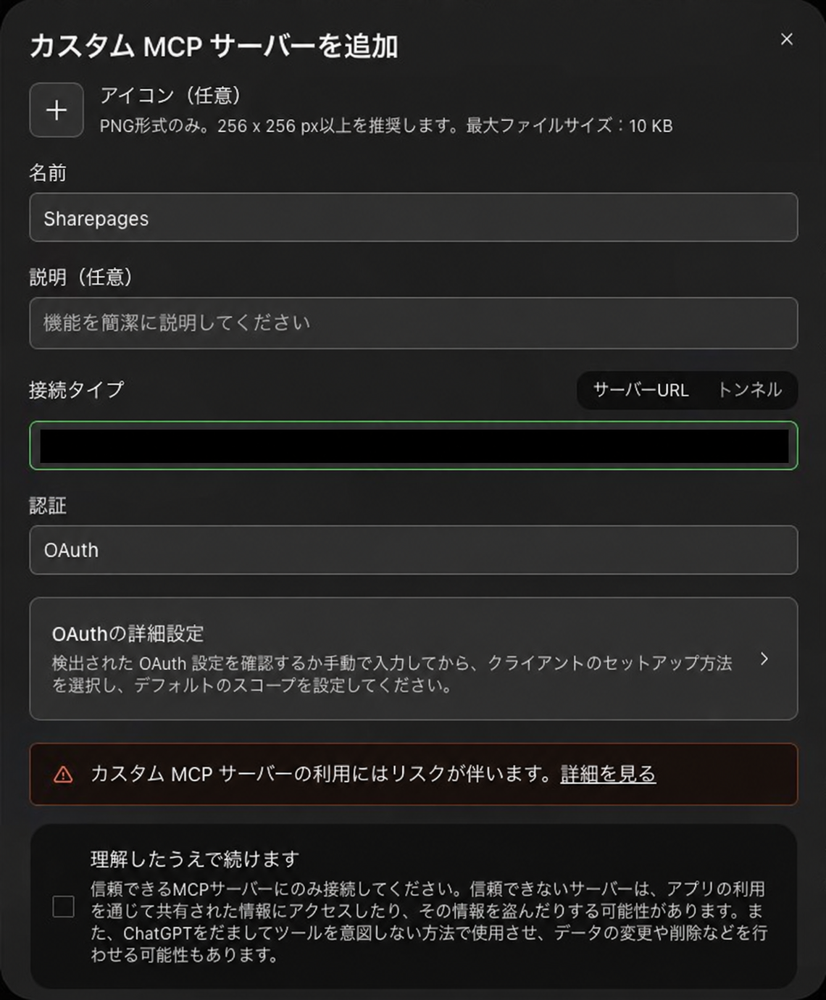
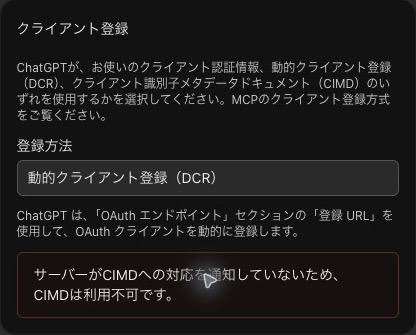

# Sharepagesの使い方

[サービス紹介](../README.md) · [セットアップ](SETUP.md) · [技術構成と開発ガイド](DEVELOPMENT.md)

## Codexから共有する

1. Sharepagesに所属組織のGoogleアカウントでログインします。
2. 「MCP接続」でCodexとOSを選び、APIキーを発行します。
3. 「接続コマンドをコピー」を押し、ターミナルで実行します。
4. Codexを再起動し、共有したいHTMLやMarkdownを指定します。

> このHTMLをSharepagesで共有して、URLを教えて。

Codexがファイルを読める環境で実行してください。接続にはNode.js 22以降とCodex CLIが必要です。キー入りのコマンドは他人に渡したり、Gitに保存したりしないでください。

キーは標準30日で期限切れになります。新しいキーを発行して接続コマンドを再実行し、Codexを再起動すると接続を更新できます。不要なキーは「MCP接続」から失効できます。

## ブラウザから共有する

1. 「共有する」でHTMLまたはMarkdownを選びます。
2. タイトル、公開期限、共有先を設定します。
3. アップロード後に表示されたURLを相手へ渡します。

HTMLは画像・CSS・スクリプトを含む自己完結した1ファイルを用意してください。別ファイルの相対参照やZIPには対応していません。標準設定は1ファイル1 MiBまで、同時に5件までです。

## 共有する相手を選ぶ

| 共有先 | 閲覧できる人 |
| --- | --- |
| 組織内でURL共有 | URLを知っている、所属組織のGoogleアカウント利用者 |
| 指定した所属組織のメールだけ | 投稿者と指定した相手。相手の「共有されたページ」にも表示 |
| 全員にURL公開 | URLを知っている全員。ログイン不要 |

指定した相手へメール通知は送りません。全員公開にする前に、本文に個人情報や秘密情報が入っていないか確認してください。

## 同じURLのページを修正する

MCPから、作成済みページのHTMLやMarkdownを差し替えられます。

> このSharepagesのURLの本文を取得して、見出しを修正し、同じページに反映して。

AIは `get_share_content` で本文を取得し、修正後の全文を `update_share_content` に渡します。更新できるのは本人が作成した有効なページだけです。同じURLのまま、タイトルやファイル名、HTML／Markdownの形式も変更できます。共有先・期限・閲覧履歴は維持されます。

ページ情報と一覧に最終更新日時を表示します。差分や変更履歴は表示しません。更新しても公開期限は延長されません。

## 期限・共有先を変更する

「マイページ」から期限や共有先を変更し、共有を削除できます。公開期限は標準14日、作成から最大30日です。期限になると閲覧・ダウンロードが止まります。

投稿者は「閲覧履歴」で、ログインした閲覧者と閲覧・ダウンロード回数を確認できます。匿名でのアクセスは人数ではなく件数として記録されます。

共有を止めても、相手がすでにダウンロードしたファイルは回収できません。手元の原本は別途保存してください。

## 任意：ChatGPT・DotsからOAuthで接続する

通常のCodex接続には、この設定は不要です。[ChatGPTの個人用プラグイン画面](https://chatgpt.com/plugins?directoryTab=personal)で「＋」→「カスタムMCPサーバーを追加」を開きます。

| 入力欄 | 設定する内容 |
| --- | --- |
| 名前 | Sharepages |
| サーバーURL | 利用するSharepagesのURLに `/mcp` を付けたもの |
| 認証 | OAuth |
| 登録方法 | 動的クライアント登録（DCR） |
| 基本スコープ | `offline_access` |

その他は自動検出された値を使います。所属組織のGoogleアカウントでログインし、連携先と要求された操作を確認して許可します。詳しい画像付き手順はSharepagesの「MCP接続」内にあります。

  
  

画像のURLは公開用に黒塗りしています。実際の接続では、利用するSharepagesの「MCP接続」に表示されたサーバーURLを入力してください。連携は同じ画面のOAuth連携一覧から解除できます。
